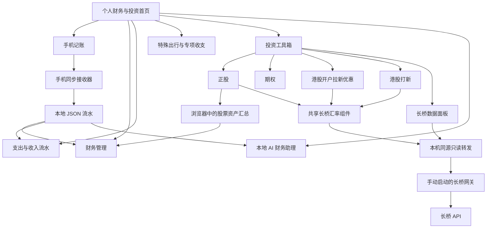

# 个人财务助理

**个人财务与投资：把日常记账、现金流、专项事件和投资复盘放在同一个工作台里。**

这是从洒一日常使用的本地工具整理出的公开源码项目。它以网页为入口，用轻量的 Python 服务连接手机与电脑，并把本地 AI 财务问答作为独立模块。项目展示页面的组织方式、代码结构和服务器搭建方法；个人账本、真实持仓、聊天记录与访问凭据不随源码发布。

项目的出发点很简单：记录要方便，统计要能解释，投资要能复盘。不同性质的钱各自成账，需要总览时再建立明确的连接。

## 按原有分类组织的模块

### 个人财务

| 板块 | 用来解决什么问题 | 页面与代码 |
| --- | --- | --- |
| 财务管理 | 汇总资产、负债、收入支出与还款；承接手机流水和股票资产汇总 | [财务管理](财务管理/index.html) |
| 手机记账 | 手动、语音和图片账单录入；按月看明细；文字与语音搜索；同步到电脑 | [手机记账](手机记账/voice-ledger/index.html) |
| 支出与收入流水 | 按周、月、年看分类、趋势、较大支出和明细；生成用于分析的数据包 | [流水分析](支出与收入流水/index.html) |
| 特殊出行与专项收支 | 一次旅行或一项活动单独建账；记录支出、返现、券与估值收入，计算净成本 | [专项收支](特殊出行与专项收支/index.html) |
| 本地 AI 财务助理 | 从白名单账本计算财务事实，附来源回答；提出修改建议后再确认写回 | [助理代码](个人财务助理/) |

### 个人投资

| 板块 | 页面里的主要内容 | 页面与代码 |
| --- | --- | --- |
| 正股 | 持仓、成本、当前价、币种、板块与仓位；持仓分布、资产趋势和每周复盘 | [股票持仓](洒一投资工具箱/股票持仓.html) |
| 期权 | 期权持仓字段；日内交易记录、盈利日历、情绪与走势复盘、交易截图及买卖点标注 | [日内期权交易记录](洒一投资工具箱/日内期权交易记录.html) |
| 港股开户拉新优惠 | 按券商记录开户奖励、交易费返还、现金券、赠股与领取状态 | [开户奖励](洒一投资工具箱/洒一开户奖励.html) |
| 港股打新 | 申购、中签、实际扣费、卖出与净盈亏记录；另有可导入资料的阅读库 | [打新记录](洒一投资工具箱/洒一港股打新.html)、[阅读库](洒一投资工具箱/港股打新阅读库.html) |

投资板块的市场数据统一以**长桥 API**为外部来源。股票持仓、开户奖励和港股打新页面通过共享组件读取长桥汇率；查询失败时明确显示缓存或手动输入状态，不把旧值标为实时数据。[长桥数据面板](洒一投资工具箱/长桥数据.html)提供股票报价、期权报价、汇率和港股 IPO 日历；账户持仓读取默认关闭，需明确启用。行情查询不会自动改写原有持仓、交易或当前价，持仓盈亏仍以页面保存的字段为准。接口能力与配置见 [长桥接入说明](docs/longbridge.md)。

开户优惠模块是记录工具。活动资格、奖励金额与到账状态需要使用者核实；它没有自动收集并验证全市场优惠的功能。打新阅读库也不会把尚未读取或核验的文章当作已掌握的判断规则。

## 页面是怎样连起来的



首页负责导航和全站备份；每个页面保留自己的录入与导出入口。日常收支先在手机保存，再同步成电脑上的 JSON；财务总览与流水分析使用同一批规范化记录。投资复盘保留独立的持仓、奖励和打新数据，避免把全部收益来源混成一张表。

## 快速体验

建议使用 Python 3.10 或更新版本；手机接收器还需要系统提供 `openssl`。以下命令均在仓库根目录执行。

```bash
SAYI_BIND_HOST=127.0.0.1 python3 手机记账/sync-server.py
```

运行后打开 `http://localhost:4176/home.html`。这个入口提供桌面页面与本地同步接口，手机 HTTPS 服务使用 `4175`。公开版默认仅监听本机；手机局域网访问、证书安装和配对步骤见 [部署说明](docs/deployment.md)。结束使用时，在启动服务的终端按 `Ctrl+C`。

本地 AI 助理和长桥网关是按需启动的独立服务。没有安装模型或没有配置长桥凭据，也可以先体验手动记账与页面结构。

启动长桥网关后，可在电脑打开 `http://localhost:4176/洒一投资工具箱/长桥数据.html`，或直接访问 `http://127.0.0.1:4190/洒一投资工具箱/长桥数据.html`。`/长桥数据.html` 短路径仅在 `4190` 提供。网关不会由记账页面自动启动，默认按两小时会话运行，终端 `Ctrl+C` 可提前退出；在途 SDK 请求可能略延迟时限检查。

| 服务 | 默认端口 | 用途 |
| --- | --- | --- |
| 手机 HTTPS 接收器 | 4175 | 配对后在手机记账与同步 |
| 桌面 HTTP 入口 | 4176 | 同一接收器进程提供电脑页面；局域网证书下载 |
| 本地 AI 财务助理 | 4188 | 只绑定本机的财务对话与修改建议 |
| 长桥只读网关 | 4190 | 独立的长桥数据接入 |
| Ollama | 11434 | 本机模型推理与规则嵌入 |

## 源码导航

```text
personal-finance-assistant/
├── index.html                       # 总入口、模块导航、全站备份
├── 财务管理/                         # 资产、负债和收支总览
├── 手机记账/                         # 记账页面、离线缓存、同步接收器
│   ├── voice-ledger/                 # 合并版语音与图片记账
│   └── sync-server.py
├── 支出与收入流水/                   # 分类、周期、趋势与分析包
├── 特殊出行与专项收支/               # 事件账本与净成本
├── 洒一投资工具箱/                   # 正股、期权、开户奖励、港股打新
├── 个人财务助理/                     # 本地 AI、SQLite 索引与受控写回
├── 品牌资产/                         # 页面使用的视觉素材
├── tools/longbridge_gateway.py       # 长桥只读数据网关
└── docs/                            # 架构、设计、部署与投资记录方法
```

运行产生的账本、数据库、备份、证书和凭据留在本机。音乐播放器代码保留，个人歌单与音频文件不在公开包内。

## 进一步阅读

- [架构与数据流](docs/architecture.md)：前端、同步接收器、本地 AI 和长桥入口各自负责什么。
- [页面设计思路](docs/page-design.md)：为什么按这些板块组织，以及每个页面怎样帮助记录与复盘。
- [服务器搭建与退出](docs/deployment.md)：本机体验、手机配对、Ollama 与端口说明。
- [长桥 API 接入](docs/longbridge.md)：凭据配置、只读接口、支持范围和数据限制。
- [投资感悟与复盘草稿](docs/investment-notes.md)：围绕正股、期权、开户优惠和打新的可编辑写作草稿。
- [源码与素材说明](NOTICE.md)：源码展示范围、第三方组件与授权说明；本仓库没有授予统一开源许可。

## 当前边界

这是一个源码展示与本地运行项目，目前没有配置 GitHub Pages 或公网业务部署。浏览器数据属于具体的协议、域名与端口，换入口时应先导出备份。手机页面缓存并不等于电脑已经收到最新账本，必须核对同步状态。

本地 AI 助理目前只处理个人收支、非投资资产、负债与现金流；其投资问答开关保持关闭。独立长桥入口的加入不会自动开启 AI 投资分析，也不会自动下单。

长桥实现已按固定的官方 `longport==4.3.7` SDK 方法签名检查，并使用模拟响应验证接口与换算逻辑。本次整理没有使用真实账户查询行情或持仓，带认证的在线 API 响应仍待使用者配置后核验。
