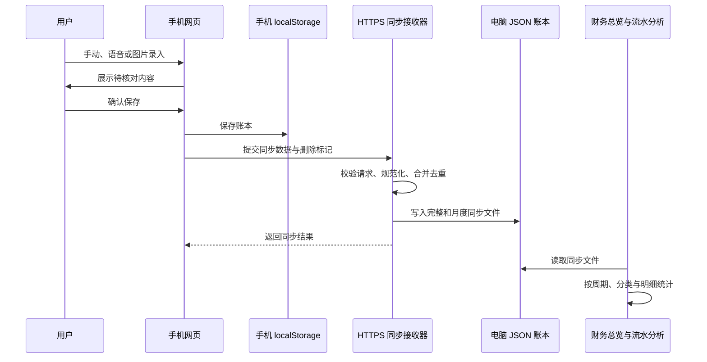
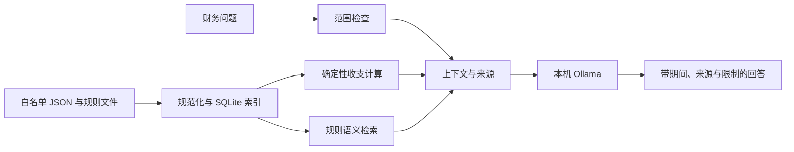
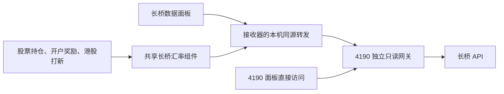

# 架构与数据流

项目采用多页面网页与轻量 Python 服务组合。大部分页面直接使用 HTML、CSS 和 JavaScript；手机同步与本地 AI 分别拥有独立后端。长桥入口用于读取外部投资数据，与原有财务文件处理保持清晰的接口边界。

## 组件职责

| 组件 | 核心文件 | 职责 |
| --- | --- | --- |
| 总入口 | `index.html` | 模块导航、同步状态、全站数据导入导出 |
| 财务网页 | 各模块的 `index.html`、`app.js`、`styles.css` | 录入、规范化、统计、图表、浏览器持久化 |
| 手机同步接收器 | `手机记账/sync-server.py` | HTTPS 手机入口、配对、同步合并、JSON 写入、桌面页面服务 |
| 手机离线缓存 | `手机记账/voice-ledger/sw.js` | 页面和本地 OCR 组件缓存；API 请求保持走网络 |
| AI 服务 | `个人财务助理/server.py` | 财务对话、索引状态、历史、修改建议与确认 |
| 财务索引 | `个人财务助理/indexer.py` | 白名单文件扫描、去重、冲突记录、确定性统计、规则检索 |
| 受控写回 | `个人财务助理/change_manager.py` | 文件哈希校验、备份、原子替换、审计与复核 |
| 模型调用 | `个人财务助理/ollama_client.py` | 本机 Ollama 对话与嵌入调用 |
| 长桥网关 | `tools/longbridge_gateway.py` | 服务端读取长桥凭据，提供独立只读数据入口 |
| 长桥汇率组件 | `洒一投资工具箱/longbridge-rates.js` | 三个原有投资页面共享汇率读取、币种对换算与来源状态 |

## 日常账本从手机到电脑

手机正式账本使用 `mobile-ledger:v1`。接收器将记录写入 `财务管理/手机记账同步/` 下的完整账本与月度文件，再转换为财务页面使用的日期、收支方向、金额、分类和备注字段。删除记录和重置时间也参与同步，避免旧备份把删除的数据重新带回来。

`4175` 与 `4176` 来自同一个接收器进程。`4175` 提供 HTTPS 手机访问；`4176` 提供电脑网页，并在局域网模式下提供本地根证书下载。非本机手机访问通过配对令牌换取安全 Cookie，写入请求另有来源检查。

语音输入使用浏览器 `SpeechRecognition` 能力。文字搜索和账本展示可以使用已缓存的页面；语音识别是否可用取决于浏览器与网络。图片识别调用仓库内的 Tesseract.js、WebAssembly 与中文识别模型，先生成可修改的草稿，再由用户确认入账。

## 页面之间的共享

| 浏览器存储项 | 主要用途 |
| --- | --- |
| `mobile-ledger:v1` | 手机记账记录 |
| `personal-asset-manager:v1` | 财务资产、负债和收支；流水分析读取其中的 transactions |
| `stockPortfolio_v3_anime` | 正股与期权持仓、资产历史与每周复盘 |
| `sayi_finance_asset_sync_v1` | 股票页面输出给财务总览的资产汇总 |
| `accountRewards_v4` | 开户与奖励记录 |
| `hkIpoRecords_v2` | 港股打新记录 |
| `sayi_special_activity_finance_v1` | 专项事件账本 |

这些键在同一浏览器来源中共享。`http://localhost:4176`、`https://localhost:4175` 与直接打开文件使用不同的来源；在一个入口看到数据，不表示其他入口自动拥有相同的浏览器存储。接收器的 JSON 同步与首页的导入导出负责跨设备和跨入口迁移。

股票页面向财务页面同步的是资产汇总，不是把每一笔投资操作重复登记成生活支出。专项账本从事件角度整理成本，使用时也应检查与日常流水是否存在重复记录。

## 本地 AI 的回答链路

`indexer.py` 使用文件哈希识别变化，统一来源记录，保留冲突和排除信息，并在 SQLite 中保存索引与对话。收入、支出、结余和分类统计由程序计算，模型依据计算结果组织解释。回答接口会提示数据截止日期和冲突数量。

默认白名单包含手机完整与月度同步文件、财务资产备份及助理规则文件。工作资料与投资资料被排除；接口也会拦截相关问题。嵌入模型用于规则检索，缺少该模型时并不等于全部财务计算不可用。

修改链路分为“提出建议”和“确认写回”。确认时检查来源文件是否仍与提议时一致，备份受影响文件，原子替换，重建索引并复核；失败时尽量恢复已替换的文件。对话数据库、审计日志和备份都是本机运行数据。

## 长桥与原账本的关系

长桥 API 是公开版外部投资数据的唯一来源。凭据仅由独立本机网关读取，使用固定版本的官方 `longport==4.3.7` SDK。已经实现股票报价、期权报价、汇率和港股 IPO 日历；持仓读取只有使用 `--allow-positions` 启动时开放。开户拉新活动、申购和中签结果没有自动数据接口。完整能力与字段约定见 [长桥说明](longbridge.md)。

电脑通过 `4176` 页面发出的 `/api/longbridge/*` 请求，由接收器转发到 `127.0.0.1:4190`。这个接口只接受本机来源与符合来源检查的读取，不向局域网手机开放投资账户接口，也不启动网关。网关必须另行手动启动；未就绪时返回明确错误。

面板完整路径是 `/洒一投资工具箱/长桥数据.html`，在 `4176` 与 `4190` 都可打开。短路径 `/长桥数据.html` 只在 `4190` 可用。

这里有三个分别保存的事实：长桥返回的市场数据、用户手动记录的持仓或交易、根据明确字段计算的本地汇总。它们不能互相冒充。网关查询不直接改写原持仓，原页面也不会因为打开长桥入口就自动变成实时估值系统。

公开版移除原投资页面的第三方自动汇率数据源。股票持仓、开户奖励和港股打新页面通过 `longbridge-rates.js` 获取长桥币种对，并按返回关系计算 USD/CNY 与 HKD/CNY。失败时保留明确的缓存状态或允许手动输入，不把缓存与用户输入标为实时长桥数据。上游汇率没有更新时间字段时，查询时间也不会被当作上游更新时间。

当前验证覆盖模拟响应、换算逻辑及固定 SDK 的真实方法签名；没有读取真实账户数据，带认证的在线响应尚未验证。

## 进程生命周期

项目按需启动，每个服务都有明确的所有者与退出方式。接收器不负责自动启动长桥网关；AI 与网关分别按需启动。长桥网关默认按两小时会话运行，在途 SDK 请求可能略延迟时限检查。关闭浏览器页不会结束网关，终端 `Ctrl+C` 可提前停止。

主页的 Chrome 应用窗口与服务控制终端分开：只关闭主页窗口不会停止接收器，关闭拥有接收器的控制终端才会停止它启动的服务。AI 的 Swift 桌面窗口关闭时只停止自己启动的 AI 服务；复用已有服务时不停止被复用的进程。直接命令行启动的接收器与 AI 通过各自终端 `Ctrl+C` 退出。

不随公开包创建常驻守护、登录项或自动重启循环。具体启动方法与端口见 [部署说明](deployment.md)。
